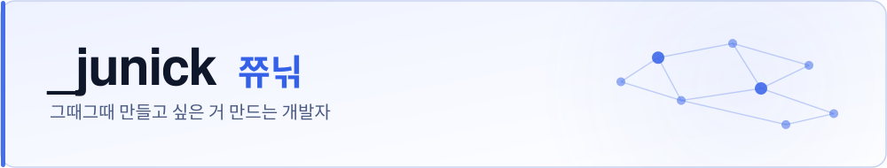
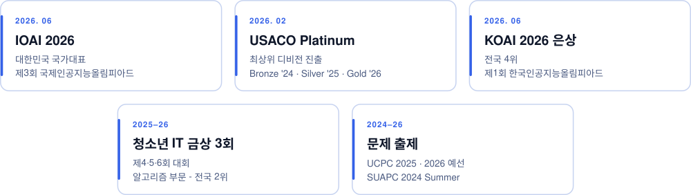
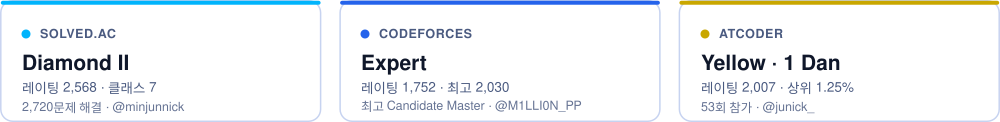

> [!WARNING]
> 이 페이지는 정기적으로 업데이트되지 않습니다. 더 정확하고 자세한 내용은 **[junick.dev](https://junick.dev)** 에 있습니다.

> [!NOTE]
> 📄 이 README는 [English 🇬🇧](README.md) 로도 제공됩니다.

  <a href="https://junick.dev">
    <picture>
      <source media="(prefers-color-scheme: dark)" srcset="https://raw.githubusercontent.com/junick1/junick1/main/assets/hero-ko-dark.svg">
      
    </picture>
  </a>

  
  
  

  
  
  

---

## 👋 소개

<table align="center">
<tr><td>

- 🇰🇷 &nbsp;**쮸닊** &nbsp;/&nbsp; 🇬🇧 &nbsp;**\_junick**
- 🎂 &nbsp;2010년 10월 15일
- 🧠 &nbsp;알고리즘 좋아합니다. 요즘엔 인공지능도 팝니다.

</td></tr>
</table>

---

## 🏆 주요 성과

  <picture>
    <source media="(prefers-color-scheme: dark)" srcset="https://raw.githubusercontent.com/junick1/junick1/main/assets/highlights-ko-dark.svg">
    
  </picture>

---

## 🤔 문제 해결

  <picture>
    <source media="(prefers-color-scheme: dark)" srcset="https://raw.githubusercontent.com/junick1/junick1/main/assets/profiles-ko-dark.svg">
    
  </picture>

  
  

<b>🥇 대회 수상</b> &nbsp;— 2023~2026, 총 25건

 

**2026**

| 시기 | 성과 | 상세 |
|:--|:--|:--|
| 2026. 05 | 🥈 **KOI 2026** 은상 | 고등부 1차 |
| 2026. 03 | 🥇 **제6회 청소년 IT경시대회** 금상 | 알고리즘 부문 · **전국 2위** |
| 2026. 02 | 🏅 **USACO Gold** 통과 | **Platinum 디비전** 진출 |
| 2026. 02 | ✅ **2026 CCC** Senior Division | 37/75 · Distinction (상위 25%) |

**2025**

| 시기 | 성과 | 상세 |
|:--|:--|:--|
| 2025. 09 | 🏆 **제7회 전국 중학생 알고리즘 경진대회** | **대상 — 전국 1위** |
| 2025. 09 | 🥇 **제5회 청소년 IT경시대회** 금상 | 알고리즘 부문 · **전국 2위** |
| 2025. 08 | 🎯 **NYPC 2025 본선** 진출 | 1519 부문 |
| 2025. 08 | ✨ **NYPC** 특별상 | 2025 · 1519 부문 |
| 2025. 07 | 🥈 **제21회 전국 중학생 IT 올림피아드** | 은상 · **전국 3위** |
| 2025. 05 | 🥈 **ACSL** 은상 | Intermediate Division, Finals |
| 2025. 03 | 🥇 **제4회 청소년 IT경시대회** 금상 | 알고리즘 부문 · **전국 2위** |
| 2025. 02 | 🏅 **USACO Silver** 통과 | Gold 디비전 진출 |
| 2025. 02 | 💯 **2025 CCC** Junior Division | **만점 — 75/75** |
| 2025. 02 | ✅ **2025 CCC** Senior Division | 50/75 · Distinction (상위 25%) |

**2024**

| 시기 | 성과 | 상세 |
|:--|:--|:--|
| 2024. 08 | ✨ **NYPC** 특별상 | 2024 · 1519 부문 |
| 2024. 07 | 🥈 **KOI 2024** 은상 | 중등부 2차 · **전국 26위** |
| 2024. 06 | 🥈 **ICT 어워드 코리아** 은상 | 알고리즘 프로그래밍 · **전국 3위** |
| 2024. 05 | 💯 **2024 CCC** Junior Division | **만점 — 75/75** |
| 2024. 05 | 🥈 **ACSL** 은상 | Junior Division, Finals |
| 2024. 05 | 🥉 **KOI 2024** 동상 | 중등부 1차 |
| 2024. 03 | 3️⃣ **GEC-Cup 2024** | 3위 |
| 2024. 02 | 🏅 **USACO Bronze** 통과 | Silver 디비전 진출 |

**2023**

| 시기 | 성과 | 상세 |
|:--|:--|:--|
| 2023. 07 | ✨ **KOI 2023** 장려상 | 중등부 2차 |
| 2023. 06 | 🥉 **ICT 어워드 코리아** 동상 | 알고리즘 프로그래밍, 중등부 |
| 2023. 05 | 🥉 **KOI 2023** 동상 | 중등부 1차 |

<b>🤖 인공지능 &amp; 머신러닝</b>

 

| 시기 | 성과 | 상세 |
|:--|:--|:--|
| 2026. 06 | 🇰🇷 **IOAI 2026 국가대표** | 제3회 국제인공지능올림피아드 (IOAI) |
| 2026. 06 | 🥈 **KOAI 2026** 은상 | 제1회 한국인공지능올림피아드 (KOAI) · **전국 4위** |

<b>🎓 수상 &amp; 교육</b>

 

| 시기 | 수상 · 이수 | 상세 |
|:--|:--|:--|
| 2025. 08 | 📜 **AI and MIT App Inventor** 과정 수료 | MIT Futurebuilders 팀 주관 |
| 2025. 07 | 🌍 **GIR 2025** 참가 | Global Innovation Race, UC Berkeley |
| 2025. 05 | ⭐️ **제2회 LG AI 청소년 캠프** 인재상 | 전국 1,300명 지원자 중 상위 15위 |
| 2025. 05 | 🔎 **제2회 LG AI 청소년 캠프** 탐색상 | 캠프 기간 중 리더십 역량 |
| 2025. 05 | 📝 **제2회 LG AI 청소년 캠프** 수료 | |

<b>✍️ 출제 · 검수 &amp; 출제 문제</b>

 

**대회 기여**

| 시기 | 역할 | 대회 |
|:--|:--|:--|
| 2026. 06 | ✍️ 출제자 | **UCPC 2026** 예선 |
| 2025. 07 | ✍️ 출제자 | **UCPC 2025** 예선 |
| 2025. 05 | 🧑‍💻 검수자 | KHSPC 2025 |
| 2025. 05 | 🧑‍💻 검수자 | PNUPC 2025 |
| 2024. 08 | ✍️ 출제자 | SUAPC 2024 Summer |

**출제 문제**

| 시기 | 문제 | 대회 |
|:--|:--|:--|
| 2026. 06 | 어려운 정렬 문제 | UCPC 2026 예선 |
| 2025. 07 | 소어그래프 | UCPC 2025 예선 |
| 2024. 08 | 한요원의 잠입 | SUAPC 2024s 예비소집 |

---

## 🛠️ 프로그래밍 언어

  <b>주력 언어</b> 
  

  <b>사용 가능 언어</b> 
  

---

  🌐 <a href="https://junick.dev">junick.dev</a> &nbsp;·&nbsp; 📝 <a href="https://junick.dev/blog/">블로그</a> &nbsp;·&nbsp; 🧩 <a href="https://junick.dev/problems/">출제 문제</a> &nbsp;·&nbsp; 📄 <a href="https://junick.dev/cv/">CV</a>
    
  

<picture>
  <source media="(prefers-color-scheme: dark)" srcset="https://capsule-render.vercel.app/api?type=waving&color=7D9DFF&height=110&section=footer">
  
</picture>
