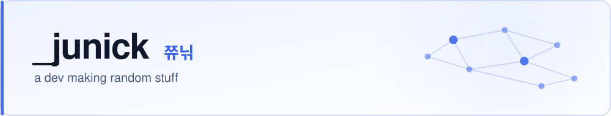
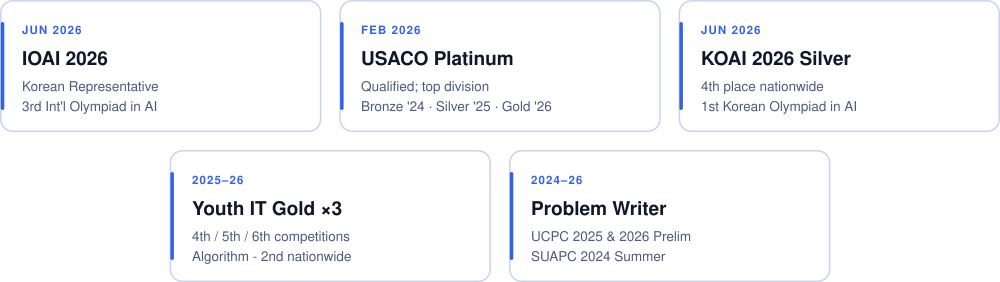
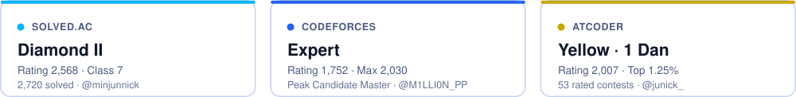

> [!WARNING]
> This page is not updated regularly. More accurate and detailed information is at **[junick.dev](https://junick.dev)**.

> [!NOTE]
> 📄 This README is also available in [한국어 🇰🇷](README-ko.md)

  <a href="https://junick.dev">
    <picture>
      <source media="(prefers-color-scheme: dark)" srcset="https://raw.githubusercontent.com/junick1/junick1/main/assets/hero-dark.svg">
      
    </picture>
  </a>

  
  
  

  
  
  

---

## 👋 About

<table align="center">
<tr><td>

- 🇰🇷 &nbsp;**쮸닊** &nbsp;/&nbsp; 🇬🇧 &nbsp;**\_junick**
- 🎂 &nbsp;15 Oct 2010
- 🧠 &nbsp;I love algorithms. Now AI too.

</td></tr>
</table>

---

## 🏆 Selected Highlights

  <picture>
    <source media="(prefers-color-scheme: dark)" srcset="https://raw.githubusercontent.com/junick1/junick1/main/assets/highlights-dark.svg">
    
  </picture>

---

## 🤔 Problem Solving

  <picture>
    <source media="(prefers-color-scheme: dark)" srcset="https://raw.githubusercontent.com/junick1/junick1/main/assets/profiles-dark.svg">
    
  </picture>

  
  

<b>🥇 Contest Results</b> &nbsp;- 25 results, 2023~2026

 

**2026**

| Date | Result | Detail |
|:--|:--|:--|
| May 2026 | 🥈 **KOI 2026** Silver Medal | High School Division, 1st Round |
| Mar 2026 | 🥇 **6th Youth IT Competition** Gold | Algorithm Section · **2nd nationwide** |
| Feb 2026 | 🏅 **USACO Gold** qualified | Passed to **Platinum Division** |
| Feb 2026 | ✅ **2026 CCC** Senior Division | 37/75 · Distinction (Top 25%) |

**2025**

| Date | Result | Detail |
|:--|:--|:--|
| Sep 2025 | 🏆 **7th National Middle School Algorithm Competition** | **Grand Prize - 1st nationwide** |
| Sep 2025 | 🥇 **5th Youth IT Competition** Gold | Algorithm Section · **2nd nationwide** |
| Aug 2025 | 🎯 Qualified for **NYPC 2025 Finals** | 1519 Division |
| Aug 2025 | ✨ **NYPC** Special Prize | 2025 · 1519 Division |
| Jul 2025 | 🥈 **21st National Middle School IT Olympiad** | Silver Medal · **3rd nationwide** |
| May 2025 | 🥈 **ACSL** Silver Medal | Intermediate Division, Finals |
| Mar 2025 | 🥇 **4th Youth IT Competition** Gold | Algorithm Section · **2nd nationwide** |
| Feb 2025 | 🏅 **USACO Silver** qualified | Passed to Gold Division |
| Feb 2025 | 💯 **2025 CCC** Junior Division | **Perfect score - 75/75** |
| Feb 2025 | ✅ **2025 CCC** Senior Division | 50/75 · Distinction (Top 25%) |

**2024**

| Date | Result | Detail |
|:--|:--|:--|
| Aug 2024 | ✨ **NYPC** Special Prize | 2024 · 1519 Division |
| Jul 2024 | 🥈 **KOI 2024** Silver Medal | Middle School Division, 2nd Round · **26th nationwide** |
| Jun 2024 | 🥈 **ICT Award Korea** Silver | Algorithm Programming · **3rd nationwide** |
| May 2024 | 💯 **2024 CCC** Junior Division | **Perfect score - 75/75** |
| May 2024 | 🥈 **ACSL** Silver Medal | Junior Division, Finals |
| May 2024 | 🥉 **KOI 2024** Bronze Medal | Middle School Division, 1st Round |
| Mar 2024 | 3️⃣ **GEC-Cup 2024** | 3rd Place |
| Feb 2024 | 🏅 **USACO Bronze** qualified | Passed to Silver Division |

**2023**

| Date | Result | Detail |
|:--|:--|:--|
| Jul 2023 | ✨ **KOI 2023** Participation Award | Middle School Division, 2nd Round |
| Jun 2023 | 🥉 **ICT Award Korea** Bronze | Algorithm Programming, Middle School |
| May 2023 | 🥉 **KOI 2023** Bronze Medal | Middle School Division, 1st Round |

<b>🤖 AI &amp; Machine Learning</b>

 

| Date | Result | Detail |
|:--|:--|:--|
| Jun 2026 | 🇰🇷 **IOAI 2026 Korean Representative** | 3rd International Olympiad in Artificial Intelligence |
| Jun 2026 | 🥈 **KOAI 2026** Silver Medal | 1st Korean Olympiad in Artificial Intelligence · **4th place** |

<b>🎓 Awards &amp; Education</b>

 

| Date | Award | Detail |
|:--|:--|:--|
| Aug 2025 | 📜 Certificate of Completion - **AI and MIT App Inventor** | Course run by the MIT Futurebuilders team |
| Jul 2025 | 🌍 Certificate of Participation - **GIR 2025** | Global Innovation Race, UC Berkeley |
| May 2025 | ⭐️ **2nd LG AI Youth Camp** - Talent Award | Top 15 of 1,300 applicants nationwide |
| May 2025 | 🔎 **2nd LG AI Youth Camp** - Exploration Award | For leadership and exploration during the camp |
| May 2025 | 📝 **2nd LG AI Youth Camp** - Completion | |

<b>✍️ Contributions &amp; Problems Authored</b>

 

**Contest contributions**

| Date | Role | Contest |
|:--|:--|:--|
| Jun 2026 | ✍️ Problem Writer | **UCPC 2026** Preliminary Round |
| Jul 2025 | ✍️ Problem Writer | **UCPC 2025** Preliminary Round |
| May 2025 | 🧑‍💻 Problem Tester | KHSPC 2025 |
| May 2025 | 🧑‍💻 Problem Tester | PNUPC 2025 |
| Aug 2024 | ✍️ Problem Writer | SUAPC 2024 Summer |

**Problems authored**

| Date | Problem | Contest |
|:--|:--|:--|
| Jun 2026 | Hard Sorting Problem | UCPC 2026 Pre |
| Jul 2025 | XOR Graph | UCPC 2025 Pre |
| Aug 2024 | Agent Han's Infiltration | SUAPC 2024s PreCall |

---

## 🛠️ Languages &amp; Tools

  <b>Main</b> 
  

  <b>Also familiar with</b> 
  

---

  🌐 <a href="https://junick.dev">junick.dev</a> &nbsp;·&nbsp; 📝 <a href="https://junick.dev/blog/">Blog</a> &nbsp;·&nbsp; 🧩 <a href="https://junick.dev/problems/">Problems</a> &nbsp;·&nbsp; 📄 <a href="https://junick.dev/cv/">CV</a>
    
  

<picture>
  <source media="(prefers-color-scheme: dark)" srcset="https://capsule-render.vercel.app/api?type=waving&color=7D9DFF&height=110&section=footer">
  
</picture>
